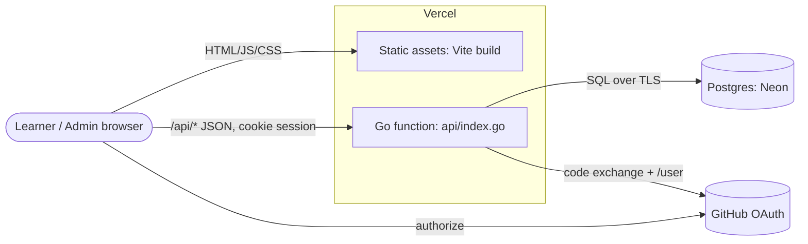
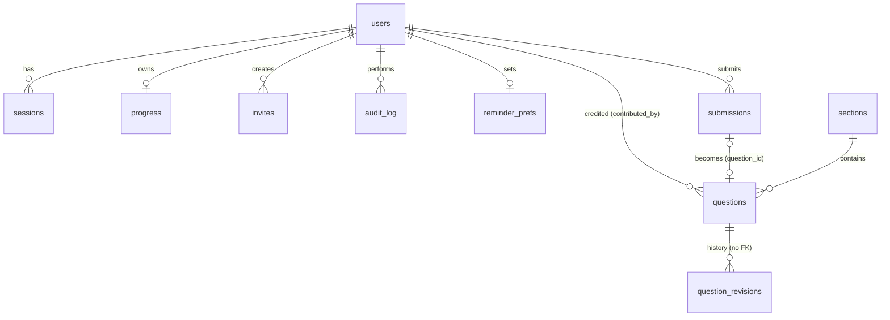

# Whetstone: Technical Specification

**Version:** 2.3 (Go backend, admin CMS, accounts, reminders, How it's built, community contributions) · **Status:** implemented · **Owner:** Anand (@anand1296) · **Last updated:** 2026-10-17

This is the single, self-contained specification of the system: what it does (product and functional requirements), how it is built (architecture, data model, API, security, operations) and why (design decisions), plus the plan for growing it from a frontend interview-prep app into a full-stack one (backend, Go, AWS, Terraform, system design, Redis, AI). The other documents go deeper on one area each and are linked where relevant.

---

## Contents

1. [Summary](#1-summary)
2. [Product](#2-product)
3. [Functional requirements](#3-functional-requirements)
4. [Non-functional requirements](#4-non-functional-requirements)
5. [System architecture](#5-system-architecture)
6. [Frontend architecture](#6-frontend-architecture)
7. [Backend architecture](#7-backend-architecture)
8. [Data model](#8-data-model)
9. [API reference](#9-api-reference)
10. [Content pipeline](#10-content-pipeline)
11. [Key flows](#11-key-flows)
12. [Security and privacy](#12-security-and-privacy)
13. [Performance, reliability and consistency](#13-performance-reliability-and-consistency)
14. [Observability](#14-observability)
15. [Testing strategy](#15-testing-strategy)
16. [Environments, deployment and CI/CD](#16-environments-deployment-and-cicd)
17. [Design decisions](#17-design-decisions)
18. [Roadmap: from frontend prep to full-stack prep](#18-roadmap-from-frontend-prep-to-full-stack-prep)
19. [Glossary](#19-glossary)

---

## 1. Summary

Whetstone is a study app for senior, lead and principal engineering interviews. Questions are grouped into **rounds** (topics). Each question is an accordion row; expanding it shows a deep answer (a 60-second spoken answer, mental model, code, trade-offs, follow-ups, mistakes, references). Learners tick questions done, resume where they left off, review done answers on a spaced schedule and keep private notes.

Version 2 adds a **Go backend** with **Postgres**:

- **Accounts** via GitHub sign-in; progress syncs across devices.
- **Roles**: one **owner** (super admin, set by configuration), **admins**, **learners**.
- **Invites**: single- or multi-use links with expiry; registration can be invite-only or open.
- **Admin console**: create, edit, reorder, publish/unpublish and delete rounds and questions with a live preview, revision history, trash and restore; sync with and export to the repository's Markdown; learner dashboard; invites; feature flags; site settings; announcements; audit log.

The same frontend still runs **without** a backend (static hosting, a single HTML file, or the claude.ai Artifact). One request at boot decides the mode.

| | Local-only mode | claude.ai Artifact mode | Server mode |
| --- | --- | --- | --- |
| Where | Any static host, a file on disk | claude.ai | Vercel (+ Neon) or Docker/binary (+ Postgres) |
| Content | Compiled into the bundle | Compiled into the bundle | Postgres, editable live |
| Progress | Browser (localStorage) | Browser + per-user cloud doc | Browser + Postgres per account |
| Identity / admin | None | claude.ai viewer; Artifact owner is admin | GitHub accounts; owner/admin/learner |
| Invites | n/a | claude.ai Share menu | Invite links from the console |

---

## 2. Product

### 2.1 Problem

Senior+ interview preparation spans many areas (language internals, frameworks, machine coding, browser, performance, testing, accessibility, security, system design, architecture, AI, leadership). Material is scattered and either shallow or book-length, and nothing tracks what you have actually mastered or keeps it fresh. Teams and mentors who prepare people together have no shared, curated, trackable bank they control.

### 2.2 Personas

| Persona | Needs |
| --- | --- |
| **Candidate** (primary): 5–15 years, interviewing in 2–8 weeks, studies in short sessions on laptop and phone | Structured path, answers deep enough for follow-ups, progress that follows them across devices |
| **Admin / mentor / organizer** (the owner and co-admins) | Curate and extend the bank without deploys, invite people, see who is progressing, announce sessions, switch features |
| **Contributor** (future) | Propose questions for review |

### 2.3 Goals

1. Interview-grade answers, consistently structured.
2. Effortless progress: tick, resume, review.
3. Retention: spaced review and practice-before-reveal.
4. Simple and fast. A deployment with a backend is private by default: visitors start at a sign-in screen and only invited people get in. Local-only builds (static host, single file, Artifact) need no account at all.
5. Admin can change content and switch features **without touching code**; anything else is a normal code change deployed by pushing to `main`.
6. The codebase is itself a learning project: it demonstrates what the answers teach, frontend and now backend.

### 2.4 Non-goals (v2)

Comments and social features, payments, native mobile apps, real-time collaborative editing of answers, multi-tenant (many independent organizations in one deployment).

### 2.5 Roles and permissions

| Capability | Anonymous | Learner | Admin | Owner |
| --- | :-: | :-: | :-: | :-: |
| Read published content (site "public") | ✓ | ✓ | ✓ | ✓ |
| Read published content (site "members") | | ✓ | ✓ | ✓ |
| Local progress, notes, review, search | ✓ | ✓ | ✓ | ✓ |
| Synced progress across devices | | ✓ | ✓ | ✓ |
| See drafts in the app | | | ✓ | ✓ |
| Create/edit/reorder/publish/delete rounds and questions, restore revisions, sync, export | | | ✓ | ✓ |
| Learner dashboard (summaries only, never notes) | | | ✓ | ✓ |
| Create learner invites, revoke invites | | | ✓ | ✓ |
| Create admin invites | | | | ✓ |
| Disable/remove learners | | | ✓ | ✓ |
| Disable/remove admins, change anyone's role | | | | ✓ |
| Submit questions for review (Contribute page) | | ✓ | ✓ | ✓ |
| Review community submissions (approve, edit and approve, reject) | | | ✓ | ✓ |
| Feature flags, announcements | | | ✓ | ✓ |
| Site settings (name, headline, registration, content access) | | | | ✓ |
| Delete own account | | ✓ | ✓ | (not from the app) |

The owner is whoever signs in with the GitHub login in `OWNER_GITHUB_LOGIN`. That account is always the owner, cannot be disabled or demoted from the app, and moves if the variable changes (the previous owner becomes an admin).

---

## 3. Functional requirements

IDs are stable; tests and ADRs refer to them.

### Studying (all modes)

| ID | Requirement |
| --- | --- |
| FR-1 | Rounds listed in order in the sidebar and overview, with per-round progress. |
| FR-2 | Each question is an accordion: collapsed shows title, level (Senior, Lead/Staff, Principal), study minutes and the first three tags; expanded shows the answer. |
| FR-3 | Answers render Markdown with callouts (TLDR, NOTE, TIP, WARNING, IMPORTANT, PRINCIPAL), highlighted code with a copy button, scrollable tables. |
| FR-4 | Tick done from the row or "Mark done & next" inside the answer. |
| FR-5 | Resume: the overview's main action opens the last visited question if not done, else the next not-done question in order. |
| FR-6 | Spaced review at 2, 5, 12, 30, 75 days; "Still solid" advances, "Needs another pass" un-ticks. *(feature flag `review`)* |
| FR-7 | Practice mode hides answers behind "answer out loud first" with a stopwatch. |
| FR-8 | Private notes per question, autosaved, 2,000 characters. *(flag `notes`)* |
| FR-9 | Search with `/` or Ctrl/⌘+K across titles, tags, summaries and opening text; accessible combobox. *(flag `search`)* |
| FR-10 | Status and level filters per round. *(flag `filters`)* |
| FR-11 | Deep links `#<round-id>` and `#<question-id>`. |
| FR-12 | Export/import progress as JSON; reset with confirmation. *(flag `progressTransfer`)* |
| FR-13 | Light/dark/system theme; responsive to small phones. |
| FR-14 | Level breakdown on the overview. *(flag `levelOverview`)* |

### Accounts and access (server mode)

| ID | Requirement |
| --- | --- |
| FR-20 | Sign in with GitHub (OAuth web flow). Local development and E2E tests may use a password-less developer sign-in, impossible in production. |
| FR-21 | First sign-in: the owner login always succeeds; otherwise a valid invite is required unless registration is "open". Returning users don't need an invite. |
| FR-22 | Invite links: role (learner, or admin when created by the owner), max uses (1–1000), expiry (1–90 days), optional note. Revocable. The owner (only) can copy the link again from the invite list. The invite page explains who invited you and for what role. |
| FR-23 | Sessions last 30 days; sign out ends the session and clears this device's local copy of progress. |
| FR-24 | Content access "members" (**default**: visitors see only a full-page sign-in screen) or "public" (anyone reads; signing in only syncs progress). |
| FR-28 | Sign-in screen first: on a members-only site a signed-out visitor sees a full-page sign-in screen (no app shell). It shows the invite (who invited you, which role) when opened from an invite link, and sign-in errors inline. |
| FR-29 | Setup screen: when the API is deployed but not configured (no database) or its database is unreachable, everyone sees a checklist of which settings are present (database, super admin, GitHub sign-in, app URL; booleans only, never values) with "Check again" and "Study offline for now". The app never pretends to sync when it can't. |
| FR-25 | Signed-in progress syncs across devices; anonymous progress done before first sign-in is adopted into the account; a device never mixes two accounts' progress. |
| FR-26 | Users can delete their account and synced data. |
| FR-27 | Sign-in errors (not invited, disabled, cancelled, expired) are explained in plain language. |

### Administration (server mode)

| ID | Requirement |
| --- | --- |
| FR-30 | Create a round (id, title, description); edit title/description; publish/hide; reorder; delete (its questions go to trash). |
| FR-31 | Create a question (title, permanent id auto-derived from the title, round, level, minutes, tags, Markdown answer) as a draft or published; edit; move between rounds; reorder; delete to trash. |
| FR-32 | Live server-rendered preview of the answer with every validation problem listed; field-level errors on save. |
| FR-33 | Publishing requires the full quality bar (TL;DR callout, ≥200 characters, known code languages and callouts, no `##` headings inside answers). Drafts may be incomplete. |
| FR-34 | Optimistic concurrency: a save based on an outdated revision is rejected with a clear message and an option to load the newer version. |
| FR-35 | Every edit and delete keeps the previous version; any version can be loaded into the editor; deleted questions can be restored (as drafts). |
| FR-36 | Drafts are visible to admins inside the app, marked "Draft"; never to learners. |
| FR-37 | Sync from repository: compare the database with the `content/*.md` deployed with the app; add what's missing, or overwrite changed questions (with history kept). Console-created content is never deleted by sync. |
| FR-38 | Export one round as Markdown or everything as a zip of `content/*.md`, in the exact repository format (round-trips through the parser). |
| FR-39 | Learner dashboard: people, roles, % complete, rounds finished, reviews due, last active, current round; filter; role changes, disable/enable, remove (per permissions). |
| FR-40 | Feature flags switch built-in features for everyone instantly. |
| FR-41 | Announcement banner with tone (info, good news, heads-up) and optional link; dismissible per user. |
| FR-42 | Site settings: app name, overview headline, registration policy, content access. |
| FR-43 | Activity log of every administrative action and sign-up, newest first, paginated. |
| FR-44 | Changes are visible to everyone without a deploy; the editor's own app view refreshes immediately. |

### Email reminders (server mode, v2.2)

| ID | Requirement |
| --- | --- |
| FR-50 | Settings has an **Email reminders** switch, **off by default**, per user. |
| FR-51 | Frequency: daily, every 3 days or weekly. Changes save immediately. |
| FR-52 | Reminders go to the user's **primary verified GitHub email** (read with the `user:email` scope at sign-in). Users without one are told to sign in again; the switch can't be turned on without an address. Email addresses are never shown to admins. |
| FR-53 | Each email contains: overall progress (done/total, %), rounds finished, reviews due (linked to `#review`), up to three rounds in progress, the **next question** (same rule as "Continue") with a deep link, a **motivational line** chosen for the learner's situation (not started, all done, away 7+ days, reviews due, nearly done, otherwise a rotating line), and a link to the app. Plain-text and HTML parts. |
| FR-54 | Every email has an unsubscribe link (confirmation page; GET never changes anything) and RFC 8058 one-click headers (`List-Unsubscribe`, `List-Unsubscribe-Post`). |
| FR-55 | "Send me a test email" sends one immediately (max 3 per hour). |
| FR-56 | A scheduler sends due reminders once a day (Vercel Cron, ~09:00 IST). Nobody gets two emails in one period, even if runs overlap; a failed send is retried on the next run. |
| FR-57 | Admins can switch the whole feature off (feature flag `emailReminders`); the job then sends nothing and the setting is hidden. |

### How it's built (all modes, v2.3)

| ID | Requirement |
| --- | --- |
| FR-60 | A **Behind the scenes → How it's built** section at the bottom of the sidebar lists walkthroughs of how the app's features were built (title, summary, tags, reading time, number of files). *(flag `howItsBuilt`)* |
| FR-61 | Each walkthrough (`#how-its-built/<id>`) explains one feature: what it does, a flow diagram, the code in the order a request flows, the decisions and their trade-offs, how it's tested, and interview angles. It lists the repository files involved, with links. |
| FR-62 | Code in walkthroughs is **quoted from the repository at build time** by symbol name (`excerpt=path#Symbol`), never pasted, and every code link (`repo:path#Symbol`) points to the exact line on GitHub **at the commit being built**. |
| FR-63 | A reference to a missing file, symbol or line range **fails** `npm run check` and CI with the walkthrough, file and symbol named. |
| FR-64 | Walkthrough bodies load lazily (one chunk) and work in every build, including the offline single-file build. |

### Contribute (v2.3)

| ID | Requirement |
| --- | --- |
| FR-70 | A **Behind the scenes → Contribute** page explains the two ways to contribute: share an interview question, or improve the code with a pull request (steps, guide, issues). *(flag `contribute`)* |
| FR-71 | Signed-in members submit a question: round (or a suggested new round), question, level, minutes, tags, Markdown answer, optional interview context (reviewer-only), and whether to be credited. A preview validates it against the same bar as published questions. |
| FR-72 | Submissions are **never visible to other learners** until approved. Limits: 5 per day and 10 pending per person. The owner is emailed about each new submission. |
| FR-73 | Members see their own submissions with status (waiting, added, not added, withdrawn), the reviewer's note, a link to the question once added, and can withdraw pending ones. |
| FR-74 | Admins review in **Admin → Submissions** (with a pending-count badge on Admin and on the tab): edit any field, choose the round and permanent id, publish now or add as a draft, add a note, then **approve** (creates the question and closes the submission atomically) or **reject**. The submitter is emailed either way. A second approval of the same submission is refused. |
| FR-75 | Approved questions credit the contributor ("Contributed by @login") when they asked for it. |
| FR-76 | Without a backend, "share a question" opens a GitHub issue form instead. |
| FR-77 | Code contributions: the repository has a contributing guide, pull request and issue templates, a code of conduct and a security policy; `CODEOWNERS` plus branch protection on `main` make the owner's approval and green CI mandatory for every merge. |

---

## 4. Non-functional requirements

| Area | Requirement | How it is met |
| --- | --- | --- |
| Performance | Static mode: no network for content. Server mode: one boot request; answers fetched per round and cached; repeat fetches revalidate with ETag (304). | §13 |
| Latency budgets | API p95 < 300 ms warm on Vercel + Neon in the same region; cold start < 3 s including migrations check. | Pool limits, lazy init, small queries |
| Availability | A backend outage or missing configuration must not break studying, and must be visible rather than silent. | The API answers `503` with a setup checklist (`not_configured` / `unavailable`); the app shows the setup screen with a "Study offline for now" escape hatch |
| Security | OWASP ASVS L1 intent: no stored XSS, CSRF, session fixation, open redirects, credential storage. | §12 |
| Privacy | Admins never see notes or per-question data; no analytics; account deletion removes progress. | Summaries computed server-side from the doc; `DELETE /api/me` |
| Accessibility | WCAG 2.2 AA intent for learner and admin UIs. | Semantic accordion, ARIA tabs and combobox, labelled fields, visible focus, keyboard-only flows tested |
| Consistency | Concurrent saves never lose data silently. | Row locks for progress, revision check for questions, advisory lock for content writes, single-use invites locked |
| Maintainability | Strict TypeScript, `go vet`, `gofmt`, no ORM, small packages; every rule has a test. | CI |
| Portability | Same handler runs serverless (Vercel) and as a binary (Docker, VPS, Fly, Render, ECS). | `api/index.go`, `cmd/server` |
| Cost | Runs on free tiers (Vercel Hobby, Neon Free, GitHub OAuth). | No paid dependencies |

---

## 5. System architecture

### 5.1 Context



Text version:

```text
Browser ──static──▶ Vercel CDN (dist/)
   │
   └──/api/*──▶ Vercel Go function ──▶ Postgres (Neon)
                        │
                        └──▶ GitHub OAuth (token exchange, profile)
```

Self-hosted, the Go binary serves both `dist/` and `/api/*` (`cmd/server`).

### 5.2 Repository layout

```text
whetstone/
├─ content/               Markdown question bank (seed + export format) and embed.go (go:embed)
├─ src/                   React app (TypeScript)
│  ├─ app/                shell, sidebar
│  ├─ features/           overview · section · review · search · settings · account · console · admin (Artifact) · announcement · reminders · howItsBuilt · contribute
│  ├─ platform/           api.ts (fetch client) · backend.ts (server mode) · launch.ts (?invite, ?auth_error) · runtime.ts (claude.ai)
│  ├─ content/            content store (bundled or server) + types
│  ├─ state/              stores, progress model, selectors, router, persistence (local, cloud, server)
│  ├─ components/ lib/ styles/ types/
├─ build/content/         TypeScript content compiler (marked + highlight.js)
├─ build/walkthroughs/    "How it's built" compiler: repo: links + live code excerpts, validated
├─ walkthroughs/          the walkthroughs (Markdown)
├─ backend/               Go packages
│  ├─ markdown/           goldmark + chroma renderer (twin of build/content/markdown.ts)
│  ├─ catalog/            content model, repository file parser/exporter, validation, compiler
│  ├─ progress/           progress document: parse, merge (LWW), summarize
│  ├─ auth/               tokens, hashing, GitHub OAuth client
│  ├─ store/              Postgres data layer + embedded SQL migrations
│  └─ server/             HTTP API: routes, middleware, handlers, settings, lazy/serverless entry
├─ api/index.go           Vercel serverless entry (one file only)
├─ cmd/server/            standalone binary (API + static files)
├─ tests/ e2e/            TS unit tests, Playwright (static + full stack)
├─ scripts/               content check (+ parity fixture), single-file and esbuild web builds
├─ docs/                  this spec, PRD, architecture, ADRs, guides
├─ Dockerfile docker-compose.yml vercel.json .env.example
├─ .github/               workflows (CI: web, go, e2e-server; optional Pages deploy), CODEOWNERS, PR + issue templates
└─ CONTRIBUTING.md CODE_OF_CONDUCT.md SECURITY.md
```

### 5.3 Dependency rules

- Frontend: `features → (state, content, platform, components, lib)`; `state` and `content` never import React components; `platform` is the only code that talks to the network or the host runtime.
- Backend: `server → (store, catalog, progress, auth, markdown)`; `store → (catalog, progress)`; `catalog → markdown`; `markdown`, `progress`, `auth` depend on nothing internal. No package imports `server`. This keeps the domain testable without HTTP or a database.

---

## 6. Frontend architecture

Deeper detail: [ARCHITECTURE.md](ARCHITECTURE.md).

### 6.1 Boot

```text
main.tsx
  initPrefs()                       theme etc. from localStorage
  readLaunchParams()                consume ?invite= and ?auth_error=, strip them from the URL
  connectBackend()                  GET /api/bootstrap (10 s timeout) if __BACKEND__ is true
     ├─ 200 JSON mode:"server"            → server mode: content, user, site, features, announcement
     ├─ 503 JSON {error, setup}           → setup mode: API deployed but not configured / DB unreachable
     └─ anything else (404, HTML, network) → local-only mode (no API here: unchanged v1 behavior)
  initProgress({serverUserId})      hydrate from localStorage, start the right sync
  initRouter(); initAnnouncement()
  render <App/>

<App/> gates before the shell:
  setup mode                          → <SetupScreen/>   checklist, "Check again", "Study offline for now"
  server mode, members-only, signed out → <SignInScreen/>  GitHub (and dev) sign-in, invite note, errors
  otherwise                           → the app (sidebar, pages, console)
```

`__BACKEND__` is a build-time constant: `true` in the Vite web build, `false` in the single-file/Artifact build (which never probes).

### 6.2 State

All client state lives in small external stores (`createStore`, read with `useSyncExternalStore`):

| Store | Holds |
| --- | --- |
| `contentStore` | source (`bundled` or `server`), version, sections, derived maps, total minutes |
| `serverStore` | mode, signed-in user, site settings, feature flags, auth methods, members-only lock |
| `progressStore` | the progress document (see §8.3) |
| `prefsStore` | theme, practice mode, filters |
| `routeStore` | current route |
| `syncStatusStore` | local · connecting · saving · synced · readonly · error |
| `announcementStore`, `launchStore` | banner; one-shot launch params |

Components read content with `useContent()` and flags with `useFeature(key)` / `useServer()`. When an admin saves, `refreshBootstrap()` replaces the content and settings; every subscribed view updates without a reload. Answers are cached per `(source, version, round)`, so a content change invalidates exactly what changed.

### 6.3 Progress sync

`syncWithRemote(store, remoteDoc, setStatus)` is one protocol for both remote kinds:

- `RemoteDoc` for the claude.ai Artifact (`db.doc(...)`), and
- `httpProgressDoc()` for the Go API: `GET /api/me/progress` on start, on tab focus and every 5 minutes while visible; `PUT /api/me/progress` returns the **merged** document, which is fed back as a snapshot.

Rules: debounced writes (1.2 s), one write in flight, skip writes when local equals remote, flush on tab hide, terminal errors (401/403/400) stop syncing and show the status. A snapshot that arrives during a write is newer than the written state, so it is not overwritten (prevents a redundant second write).

Account hygiene: the browser remembers which user id its local copy belongs to (`whetstone:progress-owner`). A different account signing in starts from its own server copy; signing out flushes then clears the local copy.

### 6.4 Admin console

`features/console/`: tabs (WAI-ARIA tabs pattern) for Content, Learners, Invites, Features & settings, Activity. Each tab loads with `useAsync` and mutates through `consoleApi` (typed calls). The question editor (`QuestionEditor.tsx`) holds the form, derives the id from the title until edited, debounces previews (450 ms, aborting stale requests), saves with the loaded revision, maps server problems to fields, guards unsaved changes (`beforeunload`, close confirmation) and supports Ctrl/⌘+S.

---

## 7. Backend architecture

### 7.1 Request pipeline

```text
recover → security headers → access log → CSRF guard → session → ServeMux route → handler
```

- **Router:** Go 1.22+ `http.ServeMux` with method and wildcard patterns (`PATCH /api/admin/sections/{id}`); no framework.
- **Handlers** decode JSON with `DisallowUnknownFields` and a 1 MiB limit, validate with `catalog`, call one `store` method, and write JSON.
- **Authorization wrappers:** `signedIn(h)` and `adminOnly(h)`; fine-grained rules (owner-only) are checked in the handler with explicit messages.
- **Errors:** one JSON shape `{"error":{"code","message","problems":[{"field","message"}]}}`; `storeError` maps data-layer errors (not found, conflict, id taken, no section, invalid order, timeout) to 404/409/422/400/503; unknown errors are logged and returned as a generic 500.

### 7.2 Packages

| Package | Responsibility | Notes |
| --- | --- | --- |
| `markdown` | Markdown → safe HTML + summary + search text | goldmark (GFM) with an AST transformer for callouts, custom renderers for code (chroma tokens mapped to highlight.js classes), raw HTML (escaped), links (scheme allow-list), images (alt text), tables (wrapped) |
| `catalog` | Section/Question model, validation, compile, repository file parse/export | Go port of `build/content`; `ParseFS(content.Files)` loads the embedded bank |
| `progress` | Progress document parse/merge/summarize | Same LWW rule as the browser; merge is commutative and idempotent (tested) |
| `auth` | Random tokens (256-bit), SHA-256 hashing, constant-time compare, GitHub OAuth client | Endpoints injectable for tests |
| `store` | All SQL, transactions, migrations | `database/sql` + `lib/pq`; each method is one transaction with a stated invariant |
| `server` | Config, routes, middleware, handlers, settings, rate limiter, serverless wrapper | `New(cfg, store, repo, log).Handler()` |
| `mail` | SMTP sender (implicit TLS on 465, STARTTLS otherwise, mandatory when authenticating), MIME multipart builder, in-memory `Recorder` for tests | Standard library only; any SMTP provider |
| `reminders` | Pure email composer: progress snapshot, next question, motivational line, HTML + text templates | No I/O; every branch unit-tested |

### 7.3 Configuration (12-factor)

| Variable | Required | Meaning |
| --- | --- | --- |
| `DATABASE_URL` (or `POSTGRES_URL`) | yes | Postgres connection string |
| `OWNER_GITHUB_LOGIN` | yes | GitHub login of the super admin |
| `GITHUB_CLIENT_ID`, `GITHUB_CLIENT_SECRET` | for sign-in | GitHub OAuth app |
| `APP_URL` | recommended | Canonical origin for the OAuth callback and Origin checks |
| `DEV_LOGIN=1` | dev/test only | Developer sign-in; ignored when `VERCEL_ENV=production` or `APP_ENV=production` |
| `DB_MAX_CONNS` | no | Pool size (default 10; 3 on Vercel) |
| `TRUST_PROXY=1` | behind a proxy | Trust `X-Forwarded-*` (automatic on Vercel) |
| `PORT`, `STATIC_DIR` | binary only | Listen port; directory of the built frontend |
| `SMTP_HOST`, `SMTP_PORT`, `SMTP_USERNAME`, `SMTP_PASSWORD`, `EMAIL_FROM` | for reminders | Any SMTP provider (Gmail app password, Resend, Brevo…); port 587 STARTTLS or 465 TLS |
| `CRON_SECRET` | for reminders | Bearer secret the scheduler must present to `GET /cron/reminders` |

### 7.4 Startup and serverless behavior

`Build()` connects (10 s ping timeout), runs migrations under a Postgres advisory lock, parses the embedded repository content and seeds the database **once** (a `seeded` marker in `settings`; deleting everything later never re-seeds). On Vercel, `server.Vercel(cfg)` wraps this in `Lazy`: initialization happens on the first request of a cold instance and is retried (at most every 3 s) if it failed, so a database that is waking up (Neon scales to zero) does not poison the instance. Without `DATABASE_URL` it answers `503 {error:{code:"not_configured"}, setup:{database,github,owner,appUrl}}` (booleans only) and the frontend shows the setup screen; if the database can't be reached it answers `503 unavailable` with the same checklist. `cmd/server` behaves the same when started without `DATABASE_URL`.

`vercel.json` rewrites `/api/:path*` to `/api/index?__route=:path*`; `rewrite()` restores the original path before routing.

### 7.5 Settings cache

`site`, `features` and `announcement` are read on every bootstrap. Each instance caches them for 5 seconds and drops the cache on its own writes. Another serverless instance may serve the old value for up to 5 s; that is acceptable for these settings.

---

## 8. Data model

### 8.1 Entity relationships



### 8.2 Tables

| Table | Key columns | Invariants |
| --- | --- | --- |
| `users` | `id`, `github_id` (unique, null for dev users), `login` (unique, lower-case), `role` (`owner`/`admin`/`learner`), `disabled`, `invited_by`, `email` (primary verified, private), timestamps | Owner determined by config at each sign-in; a renamed GitHub login frees the old name |
| `sessions` | `token_hash` (SHA-256, PK), `user_id`, `expires_at`, `last_used_at` | Raw tokens never stored; disabling a user deletes their sessions |
| `invites` | `token_hash` (unique), `token` (nullable; owner-only display), `role`, `note`, `max_uses`, `uses`, `expires_at`, `revoked_at`, `created_by` | `uses ≤ max_uses`; consumed inside the sign-in transaction with `SELECT … FOR UPDATE` |
| `sections` | `id` (slug, PK), `title`, `description`, `position`, `published`, `updated_by` | Ids share one namespace with questions (they are URL tokens) |
| `questions` | `id` (slug, PK), `section_id` (FK, cascade), `position`, `title`, `level`, `tags[]`, `minutes`, `body` (Markdown), `html`, `summary`, `search_text`, `published`, `revision` | `html/summary/search_text` are always derived from `body` at write time; `revision` increments on every save |
| `question_revisions` | `question_id`, `revision`, `action` (`update`/`delete`), `snapshot` (JSONB), `edited_by`, `edited_at` | Written before every update/delete; no FK so history survives deletion |
| `progress` | `user_id` (PK), `doc` (JSONB), `updated_at` | Only ever changed by a merge under a row lock |
| `settings` | `key` (PK), `value` (JSONB) | Keys: `site`, `features`, `announcement`, `content_version` (counter), `seeded` |
| `audit_log` | `actor_id`, `action`, `target`, `detail` (JSONB), `at` | Append-only |
| `reminder_prefs` | `user_id` (PK), `enabled` (default false), `frequency` (`daily`/`every3days`/`weekly`), `unsubscribe_token` (unique), `last_sent_at`, `last_error` | Claimed with `FOR UPDATE SKIP LOCKED` before sending; minimum gaps 20 h / 68 h / 164 h absorb the cron's within-the-hour jitter |
| `submissions` | `id`, `user_id` (FK, cascade), `section_id` or `new_section_title`, `title`, `level`, `tags[]`, `minutes`, `body`, `context`, `credit`, `status` (`pending`/`approved`/`rejected`/`withdrawn`), `reviewer_id`, `review_note`, `question_id`, timestamps | Separate from `questions`, so no reader query can see unreviewed content; approval inserts the question and closes the submission in one transaction with the row locked |
| `questions.contributed_by` | FK to `users`, `ON DELETE SET NULL` | Set on approval only when the submitter asked for credit |
| `schema_migrations` | `version` | Migrations in `backend/store/migrations/NNN_name.sql`, applied once, in order, in one transaction |

### 8.3 Progress document (JSON, shared by browser and server)

```json
{
  "version": 1,
  "questions": {
    "event-loop-rendering-order": { "done": true, "doneAt": 1760000000000, "stage": 1, "dueAt": 1760432000000, "notes": "…", "updatedAt": 1760000000000 }
  },
  "lastVisit": { "sectionId": "javascript-internals", "questionId": "event-loop-rendering-order", "at": 1760000000000 }
}
```

Merge: per question the entry with the larger `updatedAt` wins (ties keep the stored copy); `lastVisit` with the larger `at` wins. Limits: 5,000 entries, ids ≤ 120 characters, notes ≤ 2,000 characters; invalid entries are dropped, never trusted.

### 8.4 Content version and caching

Every content write increments `settings.content_version` in the same transaction. The bootstrap returns it; per-round answer responses carry `ETag: "c<version>-<p|d>-<round>"` (`d` = includes drafts) with `Cache-Control: private, no-cache`, so browsers revalidate cheaply and never see stale answers.

---

## 9. API reference

All endpoints are under `/api`, JSON in and out, same-origin, session cookie. **Every non-GET request must send `X-Requested-With: whetstone`.** Errors use the shape in §7.1.

### 9.1 Public and learner

| Method & path | Auth | Purpose / response |
| --- | --- | --- |
| `GET /health` | none | `{ok, database, version, github}`; 503 if the database is unreachable |
| `GET /bootstrap` | optional | `{mode:"server", user, site, features, announcement, auth:{github,dev}, locked, content:{version, sections:[…]}}`; drafts included for admins; `content:null, locked:true` for anonymous visitors of a members-only site (the default). Unconfigured deployment: `503 {error:{code:"not_configured"|"unavailable"}, setup:{database, github, owner, appUrl}}` |
| `GET /content/sections/{id}` | per site access | `{version, answers:{questionId: html}}` with ETag/304 |
| `GET /invites/{token}` | none (rate-limited) | `{status: active·used·expired·revoked·invalid, role, invitedBy, expiresAt, siteName}` |
| `GET /auth/github/start?invite=&next=#route` | none (rate-limited) | 302 to GitHub; sets a 10-minute HttpOnly state cookie |
| `GET /auth/github/callback?code&state` | state cookie | Verifies state, exchanges the code, signs in, sets the session cookie, 302 to `/#next` or `/?auth_error=<code>` |
| `POST /auth/dev-login {login, invite?}` | dev only | Same policy as GitHub sign-in; 404 in production |
| `POST /auth/logout` | session | Deletes the session |
| `GET /me/progress` | learner+ | The stored progress document |
| `PUT /me/progress` | learner+ (rate-limited) | Body: progress document. Merges and returns the merged document |
| `DELETE /me` | learner/admin | Deletes the account, sessions and progress (owner refused) |
| `GET /me/reminders` | learner+ | `{enabled, frequency, email, emailConfigured, available, lastSentAt, lastError, frequencies}` |
| `PUT /me/reminders {enabled, frequency}` | learner+ | 422 `no_email` without a verified address; 403 `disabled` when the admin switched the feature off |
| `POST /me/reminders/test` | learner+ (3/hour) | Sends one reminder now; 503 `email_unconfigured`, 502 `send_failed` |
| `GET /cron/reminders` | `Authorization: Bearer $CRON_SECRET` | Claims up to 50 due reminders, sends, releases failures; `{claimed, sent, failed}` or `{skipped}` |
| `GET /reminders/unsubscribe?token=` | token | HTML confirmation page (never changes state) |
| `POST /reminders/unsubscribe?token=` | token (exempt from the CSRF header rule: no cookies involved) | Turns reminders off; also the RFC 8058 one-click target |
| `POST /submissions/preview` | learner+ (rate-limited) | `{html, problems}` for a draft submission; nothing saved |
| `POST /submissions` | learner+ (5/day, 10 pending) | Body: `{sectionId \| newSectionTitle, title, level, tags, minutes, body, context, credit}`. 201 with the submission; 422 problems; 429 limits; 403 `disabled` when the `contribute` flag is off. Emails the owner |
| `GET /me/submissions` | learner+ | The caller's submissions, newest first |
| `DELETE /me/submissions/{id}` | learner+ | Withdraw a pending submission (409 `not_pending` otherwise) |

### 9.2 Admin (admin or owner)

| Method & path | Purpose |
| --- | --- |
| `GET /admin/users` | `{users:[user + summary + progressUpdatedAt], rounds:[{id,title,total}]}` |
| `PATCH /admin/users/{id}` `{role?, disabled?}` | Role changes owner-only; see §2.5 |
| `DELETE /admin/users/{id}` | Remove a user (per §2.5) |
| `GET /admin/invites` · `POST /admin/invites {role, note, maxUses, expiresInDays}` · `DELETE /admin/invites/{id}` | List (with status), create (returns `url`), revoke; the list includes `url` for the owner only |
| `GET /admin/content` | Full outline including drafts, revisions and timestamps |
| `POST /admin/sections` `{id, title, description, published?}` | Create a round (409 `id_taken`, 422 problems) |
| `PATCH /admin/sections/{id}` `{title?, description?, published?}` · `DELETE /admin/sections/{id}` | Edit / delete (questions snapshotted to trash) |
| `PUT /admin/sections/order {ids}` · `PUT /admin/sections/{id}/order {ids}` | Reorder rounds / a round's questions; must be a full permutation |
| `POST /admin/questions` · `GET/PUT/DELETE /admin/questions/{id}` | Create; read with Markdown body; update (`revision` required, 409 `conflict` if stale); delete |
| `GET /admin/questions/{id}/revisions` · `GET …/revisions/{rev}` · `POST …/revisions/{rev}/restore` | History, one snapshot, restore (re-creates as draft if deleted) |
| `GET /admin/trash` | Deleted questions not re-created |
| `POST /admin/preview` | `{html, summary, problems}` for a question draft, nothing saved |
| `GET /admin/sync` · `POST /admin/sync {overwrite}` | Plan / apply repository sync |
| `GET /admin/sections/{id}/export` · `GET /admin/export` | Markdown file / zip of `content/*.md` |
| `GET /admin/settings` · `PUT /admin/settings/{site·features·announcement}` | Read all; write one (site is owner-only) |
| `GET /admin/audit?before=<id>` | 50 entries per page, newest first |
| `GET /admin/submissions?status=pending\|all\|approved\|rejected\|withdrawn` · `GET /admin/submissions/{id}` | Review queue (default pending) |
| `POST /admin/submissions/{id}/approve {question, note}` | Creates `question` (same validation as `POST /admin/questions`), credits the author if asked, closes the submission, emails the author; 409 `not_pending` |
| `POST /admin/submissions/{id}/reject {note}` | Closes the submission with a note (≤1000 chars) and emails the author |

---

## 10. Content pipeline

```text
                    ┌──────────── build time (static modes) ────────────┐
content/*.md ──────▶│ build/content (marked + highlight.js) → virtual:content │──▶ bundle
     │              └───────────────────────────────────────────────────┘
     │  go:embed
     ▼
 backend/catalog.ParseFS ──seed once / Sync from repository──▶ Postgres (body Markdown)
                                                                 │  every save
 admin console editor ──PUT/POST──▶ catalog.Check → markdown.Render ┘→ html, summary, search_text
                                                                 │
 GET /admin/export ◀── catalog.ExportFile (same file format) ◀────┘
```

- **One format.** `content/*.md` (front matter + `## Question` + `<!-- id, level, tags, minutes -->` + answer) is the seed, the export format and the static build input. Export → parse is tested to round-trip exactly.
- **Two renderers, one contract.** The TypeScript compiler (static builds) and the Go renderer (server mode) produce the same document structure. CI renders all 119 answers with both and compares them with highlighting spans stripped (`TestParityWithStaticBuild`), and a unit test asserts both accept exactly the same fence languages.
- **Rendered at write time.** The server stores HTML next to the Markdown, so reads are a plain SELECT and the preview equals what learners will see.
- **Languages:** ts, tsx, js, jsx, html, xml, css, bash/sh/shell, json, yaml/yml, graphql, diff, http, text/txt, plus go/golang, sql, python/py, dockerfile/docker, proto/protobuf, toml, ini, hcl/terraform/tf (ready for backend and cloud rounds).

Authoring rules: [CONTENT_GUIDE.md](CONTENT_GUIDE.md).

### 10.1 Walkthroughs ("How it's built")

```text
walkthroughs/*.md ──▶ build/walkthroughs/compile.ts
                        • repo:path#Symbol  → https://github.com/…/blob/<commit>/path#L<line>
                        • ```lang excerpt=path#Symbol  → the declaration's real source + "Source: path · lines a–b"
                        • every file / symbol / range must exist, else ContentError (fails check + CI)
                     ──▶ virtual:walkthroughs (index, main bundle) + virtual:walkthroughs/content (lazy HTML)
```

- The commit is `VERCEL_GIT_COMMIT_SHA`, else `GITHUB_SHA`, else `git rev-parse HEAD`, else `main`, so deployed links point at the code that is running.
- Symbols are found by a line-based heuristic (declaration keyword + name; Go methods; SQL tables; JSON/YAML keys; Markdown headings); a declaration's block includes the comment above it and ends at its closing bracket. Excerpts are capped at 90 lines.
- Ordinary fences and inline code are left untouched, so walkthroughs can show the syntax itself.
- Rendered with the same Markdown renderer as answers (callouts, highlighting, escaped HTML, safe links).

---

## 11. Key flows

### 11.1 Sign in with GitHub (with an invite)

```mermaid
sequenceDiagram
  participant B as Browser
  participant A as API (Go)
  participant G as GitHub
  participant D as Postgres
  B->>B: open /?invite=T (token stored in memory, URL cleaned)
  B->>A: GET /api/invites/T
  A->>D: find invite by sha256(T)
  A-->>B: {status: active, role: learner, invitedBy}
  B->>A: GET /api/auth/github/start?invite=T&next=#round
  A-->>B: 302 github.com/login/oauth/authorize?state=S; Set-Cookie fl_oauth={S,T,next}
  B->>G: authorize app
  G-->>B: 302 /api/auth/github/callback?code=C&state=S
  B->>A: callback (+ fl_oauth cookie)
  A->>A: constant-time compare S
  A->>G: POST access_token(C) ; GET /user
  A->>D: BEGIN; find user; lock invite FOR UPDATE; insert user; uses+1; audit; COMMIT
  A->>D: insert session(sha256(token))
  A-->>B: 302 /#round; Set-Cookie __Host-fl_session=token (HttpOnly, Secure, Lax)
```

### 11.2 Edit and publish a question

1. Editor loads `GET /admin/questions/{id}` (body + `revision` r).
2. Typing triggers `POST /admin/preview` (debounced; stale requests aborted).
3. Save: `PUT /admin/questions/{id}` with revision r → server validates and renders → in one transaction under the content lock: check `revision == r` (else 409), snapshot the old row into `question_revisions`, update, `revision = r+1`, bump `content_version`, write `audit_log`.
4. Client refreshes the console list and calls `refreshBootstrap()`; the sidebar and pages update. Learners get the new version on their next bootstrap or answer fetch (ETag changes).

### 11.3 Progress across two devices

Laptop ticks Q (updatedAt t2) → debounced `PUT` → server locks the row, merges, stores, returns the merged doc. Phone, on focus, `GET`s the doc → merges locally (LWW) → its own pending changes go up with the next `PUT`. Both converge regardless of order (merge is commutative and idempotent).

### 11.4 Daily email reminders

```text
Vercel Cron (daily, 03:30 UTC ≈ 09:00 IST, fires within the hour)
  └─ GET /api/cron/reminders   Authorization: Bearer $CRON_SECRET
       ├─ feature off or SMTP missing → {skipped}
       ├─ ClaimDueReminders(now, 50):  one UPDATE … FROM (SELECT … FOR UPDATE SKIP LOCKED)
       │     sets last_sent_at = now for due, enabled, emailable users; returns the previous value
       └─ for each claimed user:
             load progress + published outline → reminders.Compose → SMTP send (10 s timeout)
             ok   → ReminderSent (clear last_error)
             fail → ReminderFailed (restore previous last_sent_at, store the reason) → retried next run
```

Claim-then-send gives at-most-once per period even when two runs overlap; restoring on failure turns it into at-least-once eventually. The email is pure data → template (`backend/reminders`), so its content is unit-tested without SMTP.

### 11.5 Community question submission

```text
member: #contribute form ──POST /api/submissions──▶ checkSubmission (same bar as publishing) + limits
          └─▶ submissions (pending) ──email──▶ owner
owner: Admin → Submissions → Review (edit, pick round + id) ──POST …/approve──▶ ApproveSubmission (one tx):
          lock content + submission row → must be pending → insert question → contributed_by → status approved
          → bump content version → audit ──▶ email the author (best effort, after commit)
```


---

## 12. Security and privacy

### 12.1 Threats and controls

| Threat | Control |
| --- | --- |
| Stored XSS through admin-edited content | Markdown rendered server-side: raw HTML escaped, links limited to `http(s)`, `#`, same-origin `/path`; images become text; code is escaped token spans. Tests assert `<script>`, `javascript:`, `` never survive. CSP `script-src 'self'` as a second layer. |
| CSRF | `SameSite=Lax` cookies + required `X-Requested-With` header (forces a CORS preflight the API never approves) + `Origin` must equal the app origin + `Sec-Fetch-Site` must be same-origin. |
| Login CSRF / OAuth state forgery | Random state in an HttpOnly cookie, compared in constant time, single use. |
| Open redirect after sign-in | `next` must match `^#[A-Za-z0-9_-]{0,100}$`; redirects go to the app origin only. |
| Session theft from the database | Only SHA-256 of 256-bit tokens stored. Cookies `HttpOnly`, `Secure`, `__Host-` prefix on HTTPS. |
| Privilege escalation | Server-side role checks on every admin endpoint; owner from configuration; owner cannot be changed from the app; admins cannot manage admins; unknown JSON fields rejected. Demotion takes effect on the next request (roles are read per request, not stored in the cookie). |
| Invite abuse | Hash for lookup plus the raw token stored for owner-only re-display (bounded by expiry, max uses and revoke), expiry, max uses, revocation, row lock against races (tested with 12 concurrent sign-ins), rate-limited lookups. |
| Brute force / abuse | Per-instance fixed-window limits on sign-in start, invite lookup, progress writes and previews (best-effort on serverless; see §18 for Redis). |
| Injection | Parameterized SQL only; `unnest($1::text[])` for lists. |
| Oversized input | 1 MiB body limit; field length limits; progress document caps. |
| Clickjacking, sniffing | `X-Frame-Options: DENY`, `frame-ancestors 'none'`, `nosniff`, HSTS. |
| Secrets | Only in environment variables; `.env` git-ignored; nothing secret reaches the browser. The GitHub access token is used once and discarded (scope `user:email` only, read-only). |
| Email abuse (sending to someone else's address) | Only the primary **verified** GitHub address is used; users can't type an address. Test sends are rate-limited; scheduled sends respect the frequency. |
| Email header injection | CR/LF stripped from every header value; addresses parsed with `net/mail`; covered by tests. |
| Unsubscribe link prefetching | GET shows a confirmation page; only POST (form or RFC 8058 one-click) changes state. The token can only turn reminders off. |
| SMTP credentials | Sent only over TLS (465) or after STARTTLS; the client refuses to authenticate in clear text. |
| Unreviewed or malicious community content | Submissions live in their own table that no reader query touches; they pass the same validator and safe renderer as admin content (raw HTML escaped, safe links only); per-user limits (5/day, 10 pending); only admins can approve, atomically and audited; the feature can be paused with a flag. |
| Unreviewed code reaching `main` | `CODEOWNERS` (`* @anand1296`) + branch protection: pull request required, Code Owner approval, stale approvals dismissed, last-push approval, required checks, no force-push/deletion; Actions on first-time contributors' PRs need approval. Vulnerabilities go to private advisories (`SECURITY.md`). |
| Stale or misleading documentation | Walkthrough code is quoted from source at build time and links are pinned to the built commit; broken references fail CI. |

### 12.2 Privacy

Admins see per-learner summaries computed on the server (done counts per round, due count, last activity, current round). Notes and per-question timestamps never leave the learner's document. Email addresses are stored only to send reminders the user opted into and are never shown to admins. No analytics, no third-party scripts except Google Fonts CSS. Users can delete their account. Sign-out clears the device's local copy.

---

## 13. Performance, reliability and consistency

- **Frontend:** bundled metadata (~70 KB) for instant static mode; answers lazy per round; in server mode a single bootstrap then per-round answer fetches with ETag revalidation; hover/focus prefetch of a round's answers.
- **Database access:** small pool (3 on Vercel, 10 elsewhere), idle timeout 2 min; the outline is read in one `REPEATABLE READ` read-only transaction so content and version are consistent.
- **Concurrency controls:**
  - content writes take `pg_advisory_xact_lock(content)`: positions, the shared id namespace and the version counter can't race;
  - question saves use optimistic concurrency (`revision`);
  - progress merges lock the user's row (`SELECT … FOR UPDATE`);
  - invite consumption locks the invite row;
  - migrations and seeding take their own advisory locks, so parallel cold starts are safe.
- **Degradation:** no API at boot (404, network error, timeout) → local-only mode; API present but unconfigured or database down (503 with a setup report) → setup screen with a "study offline" option. Sync errors keep progress in the browser and show the status. Unknown server errors never leak details.
- **Timeouts:** client requests 20 s (boot 10 s); GitHub calls 10–15 s; server read/write timeouts in the binary; Vercel function max 30 s.

---

## 14. Observability

- Structured JSON logs (`log/slog`): one line per request (method, path, status, duration), warnings for failed GitHub exchanges, errors with context for unexpected store failures and panics (with stack). Vercel captures stdout.
- `GET /api/health` for uptime checks.
- `audit_log` is the business-level trail (who changed what).
- Submissions and approvals are in `audit_log` (`submission.created`, `submission.approved`).
- Next steps (roadmap): request ids, OpenTelemetry traces, web-vitals from the client, error reporting.

---

## 15. Testing strategy

| Layer | Tool | What | Count |
| --- | --- | --- | --- |
| Go unit | `go test` | Markdown rendering (callouts, safety, code figures, every language), catalog parse/validate/export round-trip, progress parse/merge/summary | 15 |
| Go integration | `go test` + real Postgres (`TEST_DATABASE_URL`) | Every API flow through HTTP: bootstrap, invite policy, roles, disabling, expiry/revocation, open registration, members-only, settings, full CMS lifecycle, revisions and trash, ETag, progress merge and privacy, account deletion, CSRF, repository sync, export, GitHub OAuth against a fake GitHub, concurrent invite race, serverless entry, email reminders (cron, claim, retry, unsubscribe), community submissions (limits, invisibility, approve/credit/notify, double approval, reject, withdraw, pause) | 16 |
| Renderer parity | `go test` + TS fixture | All 119 answers identical (modulo highlighting) between Go and TypeScript renderers | 1 |
| TS unit | `node --test` | Walkthrough compiler (symbol lookup, block extraction, links, excerpts, broken references, fences left alone), compiler, progress model, search, selectors, Artifact sync, summaries, server sync over HTTP (no redundant writes), language-list parity | 37 |
| E2E static | Playwright | Studying flows, How it's built (index, walkthrough, deep link), Contribute without a backend, hosted Artifact build in a sandboxed CSP frame, mobile | 11 |
| E2E full stack | Playwright + Go server + Postgres | Owner creates a round and question with live preview, publishes, announces, switches a feature, invites; learner accepts, studies, syncs to a second device; owner sees progress; strangers refused; learner submits a question, owner approves it, the learner sees it credited | 4 |

CI runs everything on every push and pull request, Go tests with `-race`.

---

## 16. Environments, deployment and CI/CD

| Environment | Frontend | API | Database | Sign-in |
| --- | --- | --- | --- | --- |
| Local (fast) | `npm run dev` (Vite, proxies `/api` to :8080) | `npm run dev:api` | `docker compose up -d db` | Developer sign-in |
| Local (all-in-one) | `docker compose up --build` | same container | compose Postgres | Developer sign-in or GitHub |
| CI | Vite build | Go binary | Postgres service container | Developer sign-in |
| Production | Vercel static | Vercel Go function | Neon (free) | GitHub OAuth |

Production setup (one time) is in [DEPLOYMENT.md](DEPLOYMENT.md): create a Neon database from the Vercel Storage tab, create a GitHub OAuth app, set five environment variables, redeploy.

**CI/CD:** GitHub Actions (`web`, `go`, `e2e-server` jobs). Vercel builds every push: previews for branches, production for `main`. Database migrations run automatically on the first request after a deploy; they are additive and forward-only (see ADR-013).

---

## 17. Design decisions

Full records with context and consequences: [DECISIONS.md](DECISIONS.md).

| ADR | Decision |
| --- | --- |
| 001–010 | React + Vite SPA; Markdown compiled at build time; hash routing; tiny external store; local-first LWW sync; plain CSS tokens; `node --test` + Playwright; single-file build; no runtime sanitizer for build-time HTML; fixed review ladder |
| 011 | claude.ai Artifact: owner is admin, sharing via claude.ai (still applies to the Artifact build) |
| 012 | Go with the standard library router; no web framework |
| 013 | Postgres via `database/sql` + `lib/pq`, plain SQL, embedded forward-only migrations under an advisory lock |
| 014 | GitHub OAuth + opaque server-side sessions in HttpOnly cookies, not JWTs |
| 015 | CSRF: SameSite=Lax + custom header + Origin/Sec-Fetch-Site |
| 016 | Content in the database, rendered at write time; repository Markdown stays the seed and export format; parity-tested twin renderers |
| 017 | Progress merge on the server; PUT returns the merged document; polling instead of WebSockets |
| 018 | One handler, two deployments (Vercel function, binary); lazy retried init; no `internal/` |
| 019 | Feature flags are a fixed list in code; new features ship as code |
| 020 | Graceful degradation: a boot probe chooses server, setup or local-only mode |
| 022 | Private by default: members-only and invite-only, with a full-page sign-in screen |
| 023 | Email reminders: opt-in, verified GitHub email, SMTP (any provider), daily cron with claim-then-send |
| 021 | CMS safety: optimistic concurrency, revisions, trash, audit log |
| 024 | "How it's built": walkthroughs quote code by symbol at build time and link to the built commit; broken references fail CI |
| 025 | Community contributions: a separate submissions table and transactional approval; GitHub branch protection + CODEOWNERS for code |

---

## 18. Roadmap: from frontend prep to full-stack prep

The goal is a full-stack interview loop (frontend, backend and Go, cloud and AWS, infrastructure as code, system design, data and caching, AI), where **each addition to the product is also built in this codebase**, so the code keeps illustrating what the questions ask.

### 18.1 Content: tracks of rounds

Today an admin can already add rounds such as "Go Backend", "AWS", "Terraform" or "Redis" from the console, and fences for Go, SQL, Terraform/HCL, Python, Dockerfile, Protobuf and TOML render in both pipelines. As the bank grows past ~25 rounds, group rounds into **tracks**:

- Migration `002_tracks.sql`: `tracks(id, title, description, position, published)`; `sections.track_id` (FK, default `frontend`); backfill existing rounds into `frontend`.
- Repository format: `track: backend` in a round's front matter (default `frontend`), so files stay backward compatible.
- API: tracks in `/bootstrap`; `CRUD /admin/tracks`; reorder.
- UI: a track switcher above "Rounds" in the sidebar; overview ring per track; filters by track in search; per-track progress in the dashboard.
- Rename the product (site name is already a setting).

Suggested tracks and first rounds:

| Track | Rounds |
| --- | --- |
| Frontend (today) | the current 15 |
| Backend & Go | Go language and runtime (goroutines, scheduler, memory model), concurrency patterns, HTTP services and middleware, testing in Go, API design (REST, gRPC, pagination, idempotency), auth (OAuth, sessions vs JWT) |
| Data | Postgres internals (MVCC, indexes, isolation levels, locks), schema design and migrations, Redis (data structures, caching patterns, rate limiting, pub/sub, streams, persistence), queues and event-driven design |
| Cloud & AWS | Networking (VPC, subnets, NAT), compute (Lambda, ECS/Fargate, EC2), storage (S3, RDS, DynamoDB), CloudFront, IAM and least privilege, observability (CloudWatch, X-Ray), cost |
| Infrastructure as Code | Terraform (state, modules, workspaces, drift, plan/apply in CI), Docker and image hardening, CI/CD and progressive delivery |
| System Design | Full-stack designs: URL shortener, feed, chat, notifications, rate limiter, search, payments, collaborative editing, multi-region |
| AI Engineering | LLM APIs and streaming, prompt and tool design, RAG (chunking, embeddings, pgvector), evals, guardrails, cost and latency |
| Leadership | the current behavioral round, expanded |

### 18.2 Platform evolution (each step is also study material)

| Step | Change | Why / what it teaches |
| --- | --- | --- |
| 1 | **Redis** (Upstash on Vercel free tier, ElastiCache on AWS) | Shared rate limiting across instances (token bucket in Lua), settings/content cache with version-keyed invalidation, session cache, leaderboards (sorted sets), pub/sub for live admin updates |
| 2 | **Server-Sent Events** for live updates | Push content changes and announcements to open tabs; progress sync across tabs/devices without polling |
| 3 | **Tracks + mock interviews** | Timed random sets across tracks; confidence ratings feeding the review schedule (progress doc v2 with a migration) |
| 4 | **AI features** | Follow-up question generator (streamed), answer feedback against a rubric, "explain like I'm interviewing" summaries, semantic search with embeddings in Postgres (`pgvector`); keys only on the server; per-user quotas in Redis; evals in CI |
| 5 | **AWS with Terraform** | `infra/` with modules: VPC; ECS Fargate (the existing Docker image) behind an ALB, or Lambda with the same handler; RDS Postgres; ElastiCache Redis; S3 + CloudFront for the static build; Secrets Manager; Route 53 + ACM; CloudWatch dashboards and alarms; GitHub Actions with OIDC (no long-lived keys) running `terraform plan` on PRs and `apply` on main |
| 6 | **Observability** | OpenTelemetry traces (frontend → API → SQL), RED metrics, SLOs (availability, p95 latency), error budgets, structured logs with request ids |
| 7 | **Scale and resilience** | Read replicas for content reads, CDN caching of published answers keyed by content version, background jobs (queue) for AI and exports, multi-region read paths |

### 18.3 What stays stable

The progress document, the content file format and the HTTP contract are versioned and backward compatible; the local-only and Artifact modes keep working; every new capability is behind a feature flag until it is ready.

---

## 19. Glossary

| Term | Meaning |
| --- | --- |
| Round / section | A topic, e.g. "React Rendering & Internals". `section` in code. |
| Question | One interview question with a Markdown answer; id is permanent. |
| Draft | Unpublished round or question; visible to admins only. |
| Owner | The super admin, set by `OWNER_GITHUB_LOGIN`. |
| Bootstrap | The one request the app makes before rendering in server mode. |
| Content version | Counter incremented on every content change; used for caching. |
| LWW | Last-writer-wins: the merge rule for progress. |
| Parity test | Test that the Go and TypeScript Markdown renderers produce the same documents. |
| Local-only mode | The app without a backend: bundled content, browser storage. |
